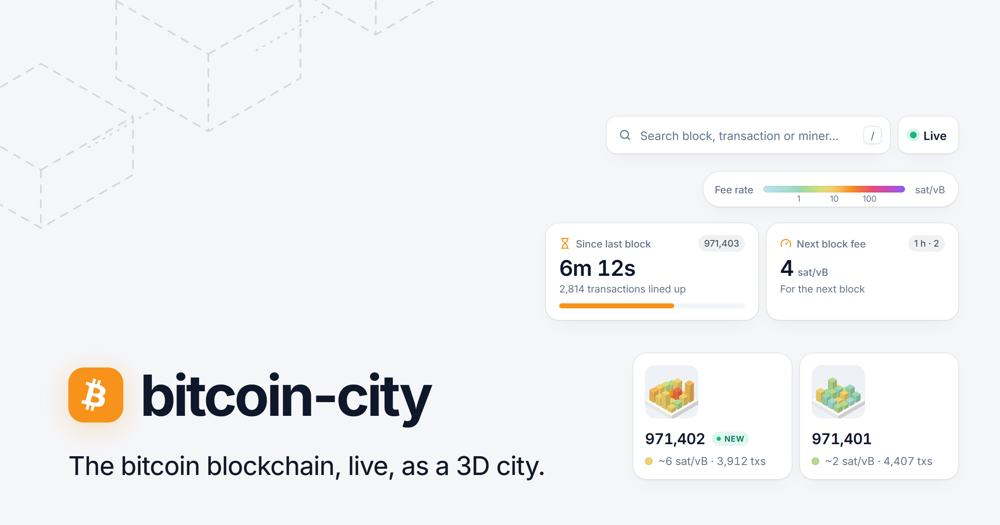

<div align="center">
<h1>bitcoin-city</h1>
<p>The bitcoin blockchain, live, as a 3D city. Every block is a district and every transaction a building: its footprint is its size, its height and colour the fee rate it paid. Watch the next block fill up from the mempool, then join the chain the moment it is mined.</p>
<p>
<code>Live blocks</code> • <code>Mempool</code> • <code>Fee rates</code> • <code>Price skyline</code>
<br>
<code>Block &amp; tx search</code> • <code>Shareable links</code> • <code>Activity feed</code> • <code>No backend</code>
</p>
<p><a href="https://mempool.psycarlo.com"><strong>mempool.psycarlo.com</strong></a></p>
</div>

<!--
## Screenshots

<details>
<summary>Show screenshots</summary>

<br />


</details>
-->

## Getting started

### Requirements

- [bun v1.4+](https://bun.sh/)

### Setup

Install dependencies with `bun`:

```bash
bun install
```

No environment variables or API keys needed: the app talks straight to public APIs from the browser.

### Run

Start the dev server:

```bash
bun dev
```

By default, the app will be available on `http://localhost:5173`.

### Build

Typecheck and build the static site into `dist/`:

```bash
bun run build
```

Preview the production build locally:

```bash
bun run preview
```

### Test

```bash
bun test
```

### Lint and format

We use [ultracite](https://docs.ultracite.ai/) with [oxlint](https://oxc.rs/docs/guide/usage/linter) and [oxfmt](https://oxc.rs/docs/guide/usage/formatter) for the linting and formatting.

Run linter checks without modifying files:

```bash
bun run check
```

Run the linter and auto-fix issues:

```bash
bun run fix
```

## Deploy

bitcoin-city is a static site, so it runs on any static host. It is set up for [Vercel](https://vercel.com/): import the repository and [vercel.json](vercel.json) takes care of the rest (bun install, Vite build, caching and security headers).

## Data

Everything comes live from public APIs, straight from the browser:

- [mempool.space](https://mempool.space/) — blocks, transactions, mempool and fee estimates (REST + WebSocket)
- [Binance](https://www.binance.com/) — BTC/USDT price and candles (REST + WebSocket)

## Tech stack

**App**

- [Vite](https://vite.dev/) — build tool and dev server
- [React 19](https://react.dev/) — UI library
- [React Three Fiber](https://r3f.docs.pmnd.rs/) + [drei](https://drei.docs.pmnd.rs/) — [three.js](https://threejs.org/) 3D scene in React
- [Zustand](https://zustand.docs.pmnd.rs/) — state management
- [shadcn/ui](https://ui.shadcn.com/) — component library (Base UI + Tailwind)
- [Tailwind CSS](https://tailwindcss.com/) — styling
- [lucide-react](https://lucide.dev/) — icons

**Tooling**

- [Bun](https://bun.sh/) — package manager and test runner
- [TypeScript](https://www.typescriptlang.org/) — types
- [ultracite](https://docs.ultracite.ai/) — oxlint + oxfmt presets
- [GitHub Actions](https://github.com/features/actions) — CI (typecheck, lint, test, build)

## Contributing

Issues and pull requests are welcome. Before opening a pull request, make sure `bun run typecheck`, `bun run check` and `bun test` pass.

## License

Released under the **MIT** license — see the [LICENSE](LICENSE) file for details.
